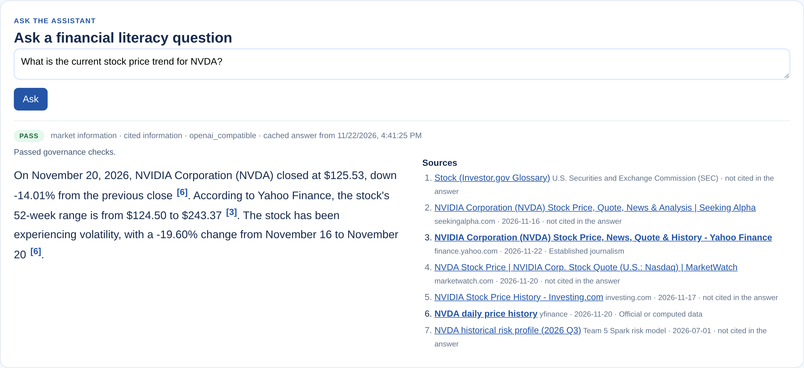

# Financial Literacy Service

An educational research assistant for beginner investors. Ask a plain-English question about a stock, a term, or recent market news and get a short answer where every factual sentence cites a numbered source, checked by a governance layer that refuses to give investment advice.

Team 5, *Databases and Cloud for AI*, UNC Charlotte, Fall 2026.



## What it does

- **Answers with evidence.** Each answer is built only from numbered sources shown under it: SEC glossary definitions, indexed news articles, the stock's stored price history, and a Spark-computed risk profile.
- **Stays educational.** Questions asking what *you* should do are redirected to the factors investors weigh. Trade requests are refused. Advice-like wording in a generated answer is caught and rewritten or blocked.
- **Shows its work.** Every answer carries a governance status (`PASS`, `REVIEW`, `BLOCK`, `SKIPPED`), the reasons behind it, the reliability tier of each cited source, and an optional per-step trace.
- **Explores the data too.** The dashboard shows a price chart with 1-month to full-history ranges, company facts, and the stock's historical risk profile.

## Try it in two minutes

Needs Docker Desktop (or Docker Engine with Compose) and Git.

```bash
git clone https://github.com/jmarsicdev/financial-literacy-project.git
cd financial-literacy-project
cp .env.example .env
scripts/demo-setup.sh
```

Then open **http://localhost:5173**. The setup script builds the stack, applies the schema, seeds prices and company data, builds the risk profiles, loads the demo answers, and checks the showcase question end to end. It is safe to run again at any time; `--fresh` wipes and rebuilds.

The demo answers ship in the repository, so the questions below respond instantly without a language model. A model is only needed for new questions (see [docs/DEVELOPMENT.md](docs/DEVELOPMENT.md) for the hosted and local options). News ingestion needs a free Tavily key in `.env`.

### Questions to try

| Ask | What it shows |
|---|---|
| What is the current stock price trend for NVDA? | Cited market answer from the stored price row plus an article; `PASS` |
| What is an ETF? | Definition cited to the SEC glossary |
| How volatile has NVDA been historically? | Cites the Spark risk profile (volatility, drawdown, beta for a past quarter) |
| How does inflation affect bond prices? | Ontology match ("Inflation") expands retrieval; flagged `REVIEW` because the claim outruns the evidence |
| Should I put $5000 into NVDA for my retirement? | Safe redirect: factors and SEC definitions, no recommendation |
| Buy 10 shares of NVDA for me | Refused with a scripted reply, no model call |

## How an answer is produced

```
question ──► 1 classify intent ──► 2 retrieve evidence ──► 3 generate ──► 4 govern ──► answer + citations + status
```

1. **Classify.** A rule-based intent classifier labels the question (educational, market information, personalized advice, transactional, out of scope) and picks a generation mode: standard, cited information, safe redirect, or no generation.
2. **Retrieve.** Matching SEC glossary definitions come first. The question is expanded through a small financial ontology (25 concepts, 24 relationships) and run as a semantic search over news chunks embedded locally with MiniLM-L6 (384-d) in pgvector; registered publishers rank ahead of unknown domains. For a question that names a ticker, the stored daily closes and the Spark risk profile are added as sources.
3. **Generate.** Qwen2.5-7B-Instruct (local Ollama) or Qwen2.5-72B (Hugging Face) writes a short answer with a `[n]` marker on every factual sentence, under rules that forbid directive advice and forward-looking price talk.
4. **Govern.** Three checks run on the draft: advice guardrails (block or review patterns), a citation validator (every financial sentence cited, every marker resolvable, metadata complete), and a source-reliability registry. A draft that fails gets one strict or citation-repair rewrite; if it still fails, a glossary-only fallback is returned.

**Source tiers.** Regulators (SEC, Investor.gov, FINRA) are Tier 1. Exchanges, government data, and this service's own stored prices and computed risk profile are Tier 2. Established journalism is Tier 3 and passes only when the answer also cites a Tier 1 or Tier 2 source. Social platforms (Tier 4) and unregistered domains always send the answer to `REVIEW`.

**Answer cache.** Generated answers are kept in Redis; a repeat question returns instantly and is labelled as cached. The showcase answers are committed in `backend/app/demo/ask_answers.json` and loaded at startup.

## By the numbers

| | |
|---|---|
| Daily price bars stored | 120,051 across 19 symbols (full history from yfinance) |
| Symbol-quarters clustered into risk profiles | 1,740 (KMeans, test silhouette 0.62) |
| SEC glossary terms / ontology | 11 definitions, 25 concepts, 24 relationships |
| Automated tests | 273 passed, 2 skipped (integration tests needing a live database), offline with fixtures |
| Governance checks | intent classifier, advice guardrails, citation validator, source registry, 102 governance tests |

The next-day price classifiers in `spark/` are kept as a documented negative result (52% vs a 53% always-up baseline) and are not used by the application.

## Architecture

| Layer | What runs | Where |
|---|---|---|
| Data sources | yfinance (prices, company data), Tavily (news), SEC Investor.gov glossary | `backend/app/ingestion/` |
| Storage | PostgreSQL 16 + pgvector (raw payloads, bars, articles, chunks, risk profiles), Redis (answer cache) | `backend/sql/` |
| Processing | Apache Spark 3.5: Bronze / Silver / Gold Parquet, Spark SQL, KMeans risk profiles | `spark/` |
| AI | MiniLM-L6 embeddings, ontology-expanded hybrid search, Qwen2.5 through an OpenAI-compatible endpoint | `backend/app/semantic_search/`, `backend/app/ontology/`, `backend/app/orchestrator/` |
| Governance | intent classification, guardrails, citation validation, source tiers | `backend/app/rag_governance/`, `backend/policies/policy.md` |
| Application | FastAPI (`/ask`, `/price-bars`, `/risk-profiles`, ...), React dashboard, Streamlit alternative | `backend/app/main.py`, `frontend/`, `app.py` |

Every external response is archived raw before normalization, so re-processing never spends API budget twice. Six Docker Compose services; only the frontend is exposed, and it proxies `/api` to the backend.

## Limitations

- 19 technology-sector tickers; risk profiles describe past quarters only and are never a forecast.
- Answers depend on which articles were ingested; a claim with no supporting source is returned as `REVIEW`, not hidden.
- Generation on a CPU-only laptop takes two to three minutes per new question; the answer cache covers repeat and demo questions.
- Single-node Spark, no authentication, no evaluation set for answer quality yet.

## More documentation

- [docs/DEVELOPMENT.md](docs/DEVELOPMENT.md): ingestion commands, configuration, model options, tests, cache tooling, Streamlit dashboard
- [DEPLOYMENT.md](DEPLOYMENT.md): services, ports, storage, configuration
- [spark/README.md](spark/README.md): the Spark pipeline, record counts, clustering results
- [backend/policies/policy.md](backend/policies/policy.md): governance policy the code implements
- [backend/ONTOLOGY.md](backend/ONTOLOGY.md): the financial ontology and hybrid search
- [docs/poster/](docs/poster/): showcase screenshots and the raw `/ask` response behind them

## Team

Josh Marsico, Himaja Goda, Jayden Parsons, Michael Simms. Instructor: Dr. Qiong Cheng.
