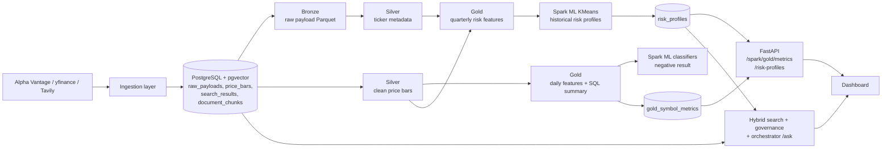

# Sprint 4 — Apache Spark Data Pipeline and Machine Learning

## Overview

This module implements the Sprint 4 data engineering and machine learning workflow using Apache Spark and PySpark.

It reads historical market data from the project's PostgreSQL database, processes it through Bronze, Silver, and Gold layers, performs Spark SQL analysis, and trains Spark ML models.

The model the application relies on is a **KMeans clustering of historical risk profiles** (one row per stock per quarter). It is descriptive: it says how a stock behaved in past quarters and makes no statement about future prices, which keeps it inside the project's no-advice policy.

Two classifiers that try to predict whether a stock closes higher on the next trading day are kept as a **documented negative result**: neither beats the always-up baseline, and their output is not stored in the database or exposed through the API.

Spark runs in a separate Docker service and does not replace or modify the existing FastAPI, React, PostgreSQL, or Redis services.

## Technology Stack

| Component | Version / Technology |
|---|---|
| Python | 3.11 |
| Java | OpenJDK 17 |
| Apache Spark | 3.5.7 |
| PySpark | 3.5.7 |
| NumPy | 1.26.4 |
| PostgreSQL driver | psycopg2-binary 2.9.10 |
| Storage format | Apache Parquet |
| Machine learning | Spark MLlib |

Spark runs in local mode using `local[*]` inside its Docker container.

## Architecture

The workflow is:

1. PostgreSQL provides raw ingestion payloads and normalized historical price bars.
2. Spark reads the source data and creates the Bronze layer.
3. Spark validates, cleans, and deduplicates price records to create the Silver layer.
4. Spark calculates historical features and next-trading-day labels to create the Gold layer.
5. Spark SQL produces a summary of historical price performance by symbol.
6. Spark parses company metadata out of the Bronze payloads, joins daily returns to the SPY benchmark, and aggregates one row per stock per quarter.
7. Spark MLlib clusters those rows into historical risk profiles with KMeans.
8. Spark MLlib also trains Logistic Regression and Random Forest next-day classifiers (negative result).
9. Models, cluster assignments, and test predictions are saved as Spark model artifacts and Parquet.

### Where Spark fits in the system



Storage (Sprint 2) feeds both the generative layer (Sprint 3: retrieval, governance, `/ask`) and the Spark layer (Sprint 4). The predictive side complements the generative side by supplying computed, citable facts about a stock's past behavior instead of leaving the language model to characterize risk on its own.

### Data layers

| Layer | Input | Output |
|---|---|---|
| Bronze | PostgreSQL `raw_payloads` | Raw payload Parquet |
| Silver | PostgreSQL `price_bars` | Validated and deduplicated price Parquet |
| Silver (metadata) | Bronze yfinance `info` payloads | Company name, asset type, sector per symbol |
| Gold | Silver price data | Feature-engineered and labeled Parquet |
| Gold (risk) | Silver prices joined to SPY returns and metadata | One row per symbol per quarter |

## Prerequisites

- Docker Desktop running.
- Docker Compose available.
- Project environment configured with the required database settings.
- Historical price data available in PostgreSQL.

## Running the Pipeline

Run commands from the repository root.

### 1. Start the required services

```powershell
docker compose up -d db backend redis spark
```

### 2. Ingest historical price data

If the database does not already contain historical price data:

```powershell
docker compose exec backend python -m app.ingestion seed-prices
```

Check ingestion status:

```powershell
docker compose exec backend python -m app.ingestion status
```

### 3. Run Bronze and Silver processing

```powershell
docker compose exec spark spark-submit jobs/bronze_silver.py
```

This job:
- Reads raw provider payloads from PostgreSQL into Bronze.
- Reads historical price bars into Silver.
- Validates price and volume fields.
- Removes invalid records.
- Deduplicates records by symbol and trading date.
- Writes Parquet output.

### 4. Generate Gold features and Spark SQL summary

```powershell
docker compose exec spark spark-submit jobs/gold_features.py
```

This job calculates:
- Daily return.
- Previous-day return.
- Five-day momentum.
- Five-day moving average.
- Twenty-day moving average.
- Twenty-day volatility.
- Next-trading-day price direction label.

It also generates a Spark SQL summary grouped by symbol. The per-symbol risk figures in that summary come from
`build_gold_features` in `backend/app/spark/gold.py`, the single tested implementation; the job's query formats them.

### 5. Cluster historical risk profiles

```powershell
docker compose exec spark spark-submit jobs/cluster_risk_profiles.py
```

The job:
- Parses company metadata from the Bronze payloads into a Silver table.
- Joins every stock's daily returns to the SPY benchmark by date.
- Aggregates per stock per quarter with Spark SQL: annualized volatility, worst drawdown within the quarter, beta versus SPY, and average intraday range.
- Splits chronologically by quarter (80/20), scales the features, and fits KMeans for k = 2 to 6.
- Selects k by training silhouette and reports the silhouette on the held-out quarters.
- Runs three Spark SQL queries over the assignments and saves the model and assignments.
- Replaces the `risk_profiles` table in PostgreSQL, which feeds `GET /risk-profiles/{symbol}`, the dashboards, and the assistant.

### 6. Train Logistic Regression

```powershell
docker compose exec spark spark-submit jobs/train_model.py
```

The job:
- Uses six historical features.
- Applies VectorAssembler and StandardScaler.
- Trains a Logistic Regression classifier.
- Evaluates predictions on a chronological test set.
- Saves the model and test predictions.

### 7. Train Random Forest

```powershell
docker compose exec spark spark-submit jobs/train_random_forest.py
```

The job:
- Uses the same six features and chronological split.
- Trains a Random Forest classifier.
- Calculates evaluation metrics and feature importance.
- Saves the model and test predictions.

## Generated Output

All generated files are stored under `spark/output/`.

| Output | Location |
|---|---|
| Bronze raw payloads | `spark/output/bronze/raw_payloads` |
| Silver price bars | `spark/output/silver/price_bars` |
| Gold features | `spark/output/gold/price_features` |
| Spark SQL summary | `spark/output/gold/sql_symbol_summary` |
| Silver ticker metadata | `spark/output/silver/ticker_metadata` |
| Gold quarterly risk features | `spark/output/gold/risk_profile_features` |
| KMeans risk profile model | `spark/output/models/risk_profile_kmeans` |
| Risk profile assignments | `spark/output/predictions/risk_profiles` |
| Logistic Regression model | `spark/output/models/logistic_regression` |
| Logistic Regression predictions | `spark/output/predictions/test_predictions` |
| Random Forest model | `spark/output/models/random_forest` |
| Random Forest predictions | `spark/output/predictions/random_forest_predictions` |

The output directory is excluded from Git because it contains generated Parquet files, model artifacts, and predictions. Run the pipeline to regenerate these outputs.

## Dataset and Processing Results

The completed pipeline processed historical data for 19 symbols.

| Processing stage | Records |
|---|---:|
| Bronze raw payloads | 20 |
| Silver input price bars | 119,956 |
| Silver valid and deduplicated records | 119,956 |
| Rejected Silver records | 0 |
| Gold labeled records | 119,937 |
| Gold rows without a next trading day | 19 |
| Gold usable ML records after feature filtering | 119,842 |
| Training records | 78,550 |
| Testing records | 41,277 |

The 19 Gold records excluded from labeling are the final available trading-day observations for each symbol because no subsequent trading day is available to calculate the label.

The chronological test period begins on **July 7, 2017**.

## Historical Risk Profiles (KMeans)

Results from a full run on November 16, 2026 (119,941 Silver price records, 19 symbols).

| Stage | Records |
|---|---:|
| Bronze payloads read | 41 |
| Silver ticker metadata (parsed from Bronze) | 19 |
| Symbol-quarters with at least 40 daily returns | 1,893 |
| Usable symbol-quarters | 1,740 |
| Dropped (quarters before SPY history begins in 1993) | 153 |
| Training symbol-quarters (before 2020) | 1,248 |
| Testing symbol-quarters (2020 onward) | 492 |

### Model selection

| k | Training silhouette | Test silhouette |
|---|---:|---:|
| 2 | 0.6670 | 0.6214 |
| 3 | 0.5685 | 0.4875 |
| 4 | 0.5562 | 0.4576 |
| 5 | 0.4704 | 0.4015 |
| 6 | 0.4676 | 0.3825 |

k = 2 is selected. The test silhouette is close to the training silhouette, so the two groups found in pre-2020 data still separate quarters from 2020 onward.

### Spark SQL: what the profiles mean

| Profile | Symbol-quarters | Avg volatility | Avg drawdown in quarter | Avg beta | Avg intraday range |
|---|---:|---:|---:|---:|---:|
| Lower historical variability | 1,231 | 26.2% | -10.5% | 1.17 | 2.05% |
| Higher historical variability | 509 | 62.3% | -27.1% | 1.82 | 4.73% |

### Spark SQL: profile mix by asset type

| Asset type | Lower | Higher |
|---|---:|---:|
| Stocks | 62.7% | 37.3% |
| ETFs | 91.1% | 8.9% |

### Sample assignments (most recent complete quarter, test set)

| Symbol | Quarter | Profile | Volatility | Drawdown | Beta |
|---|---|---|---:|---:|---:|
| SPY | 2026 Q3 | Lower | 11.0% | -3.4% | 1.00 |
| AAPL | 2026 Q3 | Lower | 28.2% | -11.0% | 0.14 |
| NVDA | 2026 Q3 | Lower | 38.3% | -10.6% | 1.89 |
| META | 2026 Q3 | Higher | 51.8% | -20.9% | 1.39 |
| AMD | 2026 Q3 | Higher | 68.1% | -23.0% | 3.41 |
| ARM | 2026 Q3 | Higher | 86.5% | -33.4% | 4.66 |

Across all quarters, SPY is in the lower group 99% of the time and ARM and PLTR are in the higher group every quarter.

### Limitations

- Two groups is a coarse description. Silhouette favors k = 2; three groups would read more naturally but separate less cleanly.
- The label reflects all four features together, so a quarter with high volatility but low beta can fall in the lower group (CRM, 2026 Q3).
- Three of the four features measure price variability and are correlated, which is part of why the separation is clean.
- Nineteen technology-heavy symbols is a narrow universe; the groups describe these symbols relative to each other, not the whole market.
- A profile describes a past quarter. It is not a forecast and must be presented with its date.

## Next-Day Direction Classifiers (Negative Result)

### Prediction objective

The classification target is:

- `1`: The next trading day's adjusted closing price is higher than the current adjusted closing price.
- `0`: The next trading day's adjusted closing price is not higher than the current adjusted closing price.

### Features

Both models use the following six features:

1. `daily_return`
2. `return_lag_1`
3. `momentum_5d`
4. `sma_5_gap`
5. `sma_20_gap`
6. `volatility_20`

The moving-average gap features represent the adjusted closing price relative to the five-day and twenty-day moving averages.

### Avoiding data leakage

The feature calculations use current and historical price observations only.

The Spark `lead()` operation is used to generate the next-trading-day target label. The future closing price is not included as a model feature.

The dataset is split chronologically rather than randomly. Training records whose next trading-day target crosses the training/test boundary are excluded from training.

This helps prevent future information from leaking into the training dataset.

## Model Evaluation

The following results were obtained from the completed test runs.

| Metric | Logistic Regression | Random Forest |
|---|---:|---:|
| Accuracy | 52.84% | 52.33% |
| Precision | 54.33% | 55.01% |
| Recall | 73.22% | 58.87% |
| Weighted F1 | 50.47% | 52.14% |
| ROC AUC | 51.99% | 52.55% |

The test set contains 22,039 positive labels out of 41,277 records. An always-positive baseline therefore achieves approximately **53.39% accuracy**.

Both models have ROC AUC values close to 0.50, indicating limited predictive discrimination on this test set. Neither model demonstrates strong predictive performance.

Logistic Regression has higher recall, while Random Forest has slightly higher precision, weighted F1, and ROC AUC.

### Random Forest feature importance

| Feature | Importance |
|---|---:|
| volatility_20 | 0.197423 |
| daily_return | 0.166940 |
| sma_20_gap | 0.165647 |
| sma_5_gap | 0.156835 |
| return_lag_1 | 0.156826 |
| momentum_5d | 0.156329 |

## Important Notes

- This is an educational machine learning demonstration.
- The models are not investment recommendations or financial advice.
- Historical price patterns do not guarantee future performance.
- The evaluation results do not establish that either model can reliably predict future stock prices.
- Spark is currently configured for local execution in a single container, not a distributed multi-node cluster.
- Source rows are fetched from PostgreSQL through the driver and then handed to Spark. Reading with Spark's JDBC source would let Spark partition the load itself and is the natural next step.
- The per-symbol summary served by `GET /spark/gold/metrics` is ordered by symbol and deliberately omits any next-day statistic.

## Tests and local settings

```powershell
docker compose exec spark python -m pytest tests -v
```

- `SPARK_OUTPUT` overrides the output folder (default `/opt/spark-app/output`).
- Databases created before this sprint need `backend/sql/migrations/004_gold_symbol_metrics.sql` and `005_risk_profiles.sql` applied once.

## Reproducibility

Run the jobs in the following order:

1. `bronze_silver.py`
2. `gold_features.py`
3. `cluster_risk_profiles.py`
4. `train_model.py`
5. `train_random_forest.py`

Ensure the database has historical price data before running the pipeline.

Generated outputs are not committed to Git. The source code and configuration files are sufficient to regenerate them.
